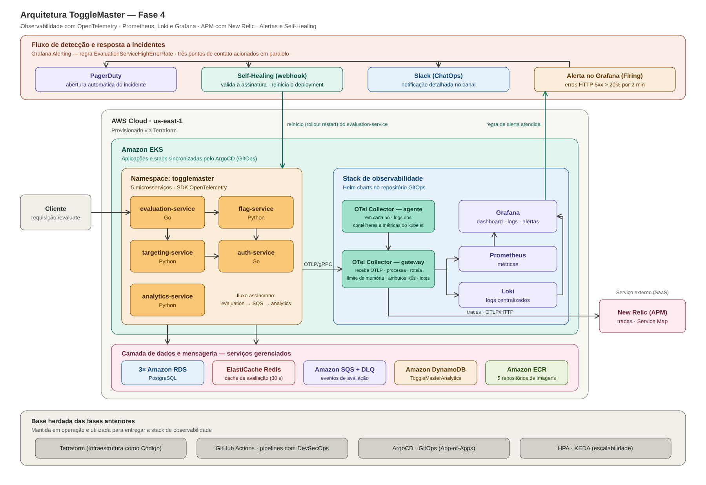

# ToggleMaster - Fase 4: Observabilidade Total e Resposta Ativa


Projeto do **Tech Challenge - Fase 4 (Pós-Tech FIAP - DevOps e Arquitetura Cloud)**. Sobre a
base das fases anteriores (5 microsserviços, Terraform, pipelines DevSecOps e GitOps com
ArgoCD), esta fase acrescenta:

- **Instrumentação com OpenTelemetry** dos cinco microsserviços (Go e Python): traces,
  métricas de aplicação e logs correlacionados por `trace_id`.
- **OpenTelemetry Collector** como peça central (agente em cada nó + gateway), roteando
  métricas para o **Prometheus**, logs para o **Loki** e traces para o **New Relic**.
- **Grafana** com dashboard customizado (cluster, microsserviços, fila SQS e logs).
- **Alerta inteligente** de taxa de erros 5xx, com incidente no **PagerDuty** e notificação
  no **Slack**.
- **Self-Healing**: automação que recebe o alerta por webhook assinado e reinicia o serviço
  afetado sem intervenção humana.



---

## Integrantes do Grupo

- **Erisvam Herdley Da Silva Santos**
- **Felipe Sousa Da Silva**
- **Rafael Andrade Ferretto**

---

## Como criar o ambiente

O guia completo, do zero até o experimento de falha, está em
**[docs/fase4/passo-a-passo.md](docs/fase4/passo-a-passo.md)**. Resumo:

```bash
# 1. Infraestrutura (cerca de 20 a 30 min)
./scripts/setup-remote-backend.sh
cp terraform/terraform.tfvars.example terraform/terraform.tfvars   # ajuste use_aws_academy
(cd terraform && terraform init && terraform apply)

# 2. GitOps apontando para o seu repositório e a sua conta AWS
./scripts/fase4/00-set-repo-url.sh https://github.com/<usuario>/<repositorio>
./scripts/fase4/01-sync-gitops-config.sh
git add . && git commit -m "feat: fase 4" && git push -u origin main   # dispara os 6 pipelines

# 3. Cluster: KEDA + Applications do ArgoCD + segredos da observabilidade
./scripts/fase4/03-bootstrap-cluster.sh
./scripts/fase4/02-create-observability-secrets.sh   # New Relic, PagerDuty e Slack

# 4. Uso
./scripts/fase4/04-port-forward.sh      # Grafana :3000, Prometheus :9090, ArgoCD :8081
./scripts/fase4/05-seed-demo-data.sh    # flag e regra de demonstração
./scripts/fase4/06-generate-load.sh     # tráfego contínuo

# 5. Experimento de falha e Self-Healing
./scripts/fase4/07-inject-failure.sh

# 6. Ao terminar
./scripts/teardown-aws.sh
```

---

## Estrutura do repositório

```text
.
├── .github/workflows/                 # 6 pipelines DevSecOps (5 microsserviços + self-healing) e validação do Terraform
├── services/
│   ├── auth-service/                  # Go    - telemetry.go (OpenTelemetry)
│   ├── evaluation-service/            # Go    - telemetry.go, spans de Redis/SQS, falha controlada
│   ├── flag-service/                  # Python - telemetry.py
│   ├── targeting-service/             # Python - telemetry.py
│   ├── analytics-service/             # Python - telemetry.py, span CONSUMER da fila SQS
│   └── self-healing/                  # Python - webhook do alerta -> rollout restart
├── gitops/
│   ├── argocd-apps/
│   │   ├── root-application.yaml              # microsserviços (Fase 3)
│   │   └── observability-applications.yaml    # stack de observabilidade (Fase 4)
│   ├── apps/                                  # manifestos dos microsserviços (com variáveis OTEL_*)
│   └── observability/
│       ├── otel-collector/                    # agente (DaemonSet) e gateway (Deployment)
│       ├── values/                            # valores dos charts: Prometheus, Loki e Grafana (alertas inclusos)
│       ├── grafana-dashboards/                # dashboard customizado (JSON + kustomize)
│       └── self-healing/                      # Deployment, Service e RBAC mínimo
├── terraform/                         # infraestrutura (EKS, RDS, Redis, SQS, DynamoDB, ECR, ArgoCD)
├── scripts/
│   ├── fase4/                         # criação do ambiente, carga, falha controlada e evidências
│   └── ...                            # backend remoto, testes locais e teardown (Fase 3)
└── docs/
    ├── fase4/                         # passo a passo, arquitetura, runbook e roteiro de demonstração
    └── ...                            # documentação da Fase 3 (arquitetura, DevSecOps, GitOps)
```

---

## Documentação

| Documento | Conteúdo |
|---|---|
| [Passo a passo](docs/fase4/passo-a-passo.md) | Criação do ambiente, experimento de falha, evidências e solução de problemas |
| [Observabilidade](docs/fase4/observabilidade.md) | Arquitetura do OTel, contrato de telemetria, alerta, Self-Healing e mapa de requisitos |
| [Runbook](docs/fase4/runbook-evaluation-5xx.md) | Resposta ao alerta `EvaluationServiceHighErrorRate` |
| [Demonstração](docs/fase4/demonstracao.md) | Roteiro do vídeo (até 25 minutos) |
| [Arquitetura AWS](docs/arquitetura.md), [DevSecOps](docs/devsecops.md), [GitOps](docs/gitops.md) | Base das fases anteriores |

---

## Testes locais

```bash
./scripts/test-devsecops-local.sh    # testes unitários Go e Python + validação do Terraform
```

Os testes não dependem de rede: sem a variável `OTEL_EXPORTER_OTLP_ENDPOINT` a telemetria
fica inativa (no-op).

---

## Escolhas técnicas

- **OpenTelemetry Collector em agente + gateway:** o agente lê o que só existe no nó (logs dos
  contêineres e métricas do kubelet); o gateway concentra o processamento e a exportação. As
  aplicações conhecem um único endereço OTLP e a troca de backend não exige alterar código.
- **New Relic (APM):** ingestão nativa de OTLP (sem agente proprietário) e plano gratuito
  permanente suficiente para o laboratório.
- **PagerDuty:** integração nativa com o Grafana (Events API v2); o Opsgenie teve a venda
  encerrada pela Atlassian em 2025, com fim de suporte previsto para 2027.
- **Self-Healing como serviço no cluster:** reage em segundos ao webhook do Grafana, com
  assinatura HMAC, escopo restrito a um deployment e permissões mínimas de RBAC.
