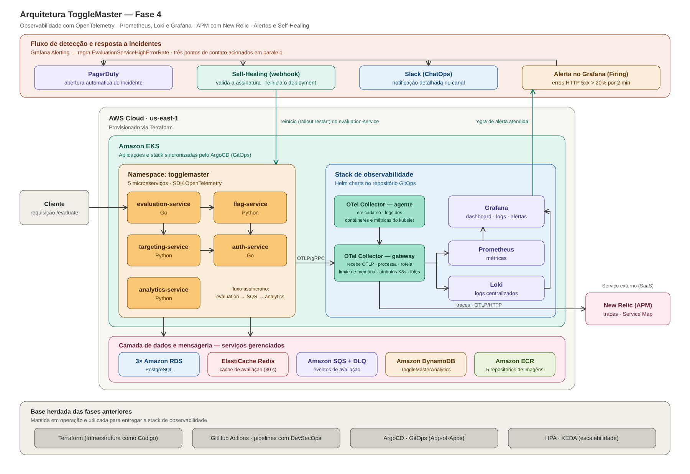

# Observabilidade e resposta a incidentes — arquitetura da Fase 4



## 1. Caminho da telemetria

| Sinal | Origem | Coleta | Destino |
|---|---|---|---|
| **Métricas de aplicação** | SDK OpenTelemetry nos 5 microsserviços (OTLP/gRPC) | gateway do Collector | Prometheus (scrape do gateway em `:8889`) |
| **Métricas de infraestrutura** | kubelet de cada nó; cAdvisor; kube-state-metrics | agente do Collector (`kubelet_stats`) e scrape direto do Prometheus | Prometheus |
| **Logs** | saída padrão/erro dos contêineres (`/var/log/pods`) | agente do Collector (`file_log`) → gateway | Loki (endpoint OTLP nativo) |
| **Traces** | SDK OpenTelemetry nos 5 microsserviços (OTLP/gRPC) | gateway do Collector | New Relic (OTLP/HTTP) |

O **gateway** é o único endereço que as aplicações conhecem
(`otel-collector-gateway.observability.svc.cluster.local:4317`). Trocar um backend exige
alterar somente `gitops/observability/otel-collector/20-gateway-config.yaml`.

Processadores do gateway: `memory_limiter` (proteção em picos), `k8s_attributes`
(deployment, nó, namespace) e `batch` (envio em lotes). Os exportadores têm fila e
novas tentativas configuradas para tolerar indisponibilidade dos destinos.

## 2. Contrato de telemetria

### Atributos de recurso (todos os sinais)

| Atributo | Valor |
|---|---|
| `service.name` | `auth-service`, `flag-service`, `targeting-service`, `evaluation-service`, `analytics-service` |
| `service.namespace` | `togglemaster` |
| `service.version` | versão da aplicação (`SERVICE_VERSION`) |
| `deployment.environment.name` | ambiente (`DEPLOYMENT_ENVIRONMENT`, padrão `lab`) |
| `service.instance.id`, `k8s.pod.name`, `k8s.namespace.name`, `k8s.node.name` | identificação do pod (Downward API) |

### Métricas de aplicação

| Métrica (OpenTelemetry) | Nome no Prometheus | Atributos |
|---|---|---|
| `togglemaster.http.server.requests` | `togglemaster_http_server_requests_total` | `http.request.method`, `http.route`, `http.response.status_code`, `outcome` |
| `togglemaster.http.server.duration` | `togglemaster_http_server_duration_seconds_{bucket,sum,count}` | os mesmos |
| `togglemaster.cache.operations` | `togglemaster_cache_operations_total` | `operation` (get/set), `result` (hit/miss/ok/error) |
| `togglemaster.sqs.messages.published` | `togglemaster_sqs_messages_published_total` | `result` |
| `togglemaster.analytics.events.processed` | `togglemaster_analytics_events_processed_total` | `result` |
| `togglemaster.analytics.processing.duration` | `togglemaster_analytics_processing_duration_seconds_{bucket,sum,count}` | `result` |

Regras:

- o endpoint `/health` não gera métricas de negócio nem spans;
- `http.route` é sempre a rota registrada (ex.: `/flags/<string:name>`) ou `unmatched`;
- identificadores de usuário, nomes de flags, IDs de trace, corpo de requisições e mensagens
  de erro **não** são usados como rótulos (cardinalidade controlada);
- os logs não registram credenciais, tokens nem cabeçalhos de autorização.

### Traces e propagação de contexto

- HTTP: W3C Trace Context (`traceparent`/`tracestate`).
- SQS: os mesmos campos viajam em `MessageAttributes` do tipo `String`; o evaluation-service
  cria um span `PRODUCER` e o analytics-service um span `CONSUMER` no mesmo trace.
- Logs: cada linha termina com `trace_id=... span_id=...` quando há span ativo.

Trace de uma requisição `GET /evaluate` (cache vazio):

```text
[evaluation-service] GET /evaluate (SERVER)
  [evaluation-service] redis GET (CLIENT)
  [evaluation-service] HTTP GET (CLIENT)
    [flag-service] GET /flags/<string:name> (SERVER)
      [flag-service] GET (CLIENT)
        [auth-service] GET /validate (SERVER)
          [auth-service] SELECT api_keys (CLIENT)
      [flag-service] SELECT flags (CLIENT)
  [evaluation-service] HTTP GET (CLIENT)
    [targeting-service] GET /rules/<string:flag_name> (SERVER)
      [targeting-service] GET (CLIENT)
        [auth-service] GET /validate (SERVER)
          [auth-service] SELECT api_keys (CLIENT)
      [targeting-service] SELECT targeting_rules (CLIENT)
  [evaluation-service] redis SET (CLIENT)
  [evaluation-service] send ToggleMasterEvents (PRODUCER)
    [analytics-service] process ToggleMasterEvents (CONSUMER)
      [analytics-service] DynamoDB PutItem (CLIENT)
```

## 3. Alerta, incidente, ChatOps e Self-Healing

| Item | Configuração |
|---|---|
| Regra | `EvaluationServiceHighErrorRate` (Grafana Alerting, provisionada por arquivo) |
| Condição | mais de 20% de respostas HTTP 5xx do evaluation-service nos últimos 5 min, com pelo menos 20 requisições no período |
| Espera | a condição precisa se manter por 2 min (`for: 2m`) |
| Ponto de contato | `togglemaster-resposta-a-incidentes`, com três integrações em paralelo |
| PagerDuty | Events API v2: abre o incidente, agrupa repetições e resolve quando o alerta normaliza |
| Slack | mensagem com serviço, severidade, horário, taxa de erros e links (dashboard, incidente, runbook) |
| Self-Healing | webhook interno assinado com HMAC-SHA256 (`X-Grafana-Alerting-Signature` + carimbo de tempo) |

A automação (`services/self-healing`) valida a assinatura e o horário, aceita somente a regra
e o deployment autorizados, ignora eventos resolvidos e ocorrências já tratadas, respeita um
intervalo mínimo entre intervenções e então executa o equivalente a
`kubectl rollout restart deployment/evaluation-service`, acompanhando o rollout até as novas
réplicas ficarem disponíveis. A ServiceAccount só tem permissão de `get` e `patch` nesse
deployment (`gitops/observability/self-healing/rbac.yaml`).

## 4. Onde está cada requisito do enunciado

| Requisito | Arquivos |
|---|---|
| Prometheus, Loki e Grafana via Helm charts no GitOps | `gitops/argocd-apps/observability-applications.yaml`, `gitops/observability/values/*.yaml` |
| Dashboard customizado | `gitops/observability/grafana-dashboards/togglemaster-overview.json` |
| OTel Collector (agente + gateway) | `gitops/observability/otel-collector/` |
| Instrumentação do código | `services/*/telemetry.go`, `services/*/telemetry.py` e handlers |
| APM (New Relic), tracing distribuído e Service Map | exportador `otlp_http/newrelic` do gateway |
| Alerta inteligente | bloco `alerting.rules.yaml` em `gitops/observability/values/grafana-values.yaml` |
| PagerDuty e Slack | bloco `alerting.contactpoints.yaml` do mesmo arquivo |
| Self-Healing | `services/self-healing/`, `gitops/observability/self-healing/`, `.github/workflows/ci-self-healing.yml` |
| Falha proposital | `services/evaluation-service/handlers.go` (`faultInjected`) e `scripts/fase4/07-inject-failure.sh` |

## 5. Limitações conhecidas (laboratório)

- Prometheus e Loki usam disco efêmero e retenção curta (6 h e 24 h): os dados se perdem se os
  pods forem recriados.
- Grafana e ArgoCD são acessados por `kubectl port-forward`.
- O Self-Healing trata falhas que a substituição dos pods elimina; outras (ex.: banco de dados
  fora do ar) continuam exigindo a equipe acionada pelo PagerDuty.
- As credenciais dos microsserviços continuam em `gitops/apps/base/secrets.yaml`, como na
  Fase 3; as da observabilidade ficam apenas em Secrets criados por script.
